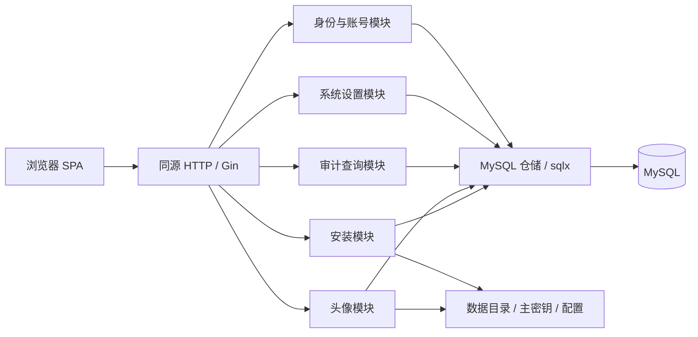

# 架构与技术选型

范围与已确认规则见 [设计入口](README.md)。采用模块化单体：一个 Go 进程、一个 MySQL 数据库、一份本地持久化目录；浏览器与 API 同源部署。

## 1. 当前基础

使用 Go `1.26.4`、Gin `1.12.0`，保留 SPA 与迁移随二进制嵌入的交付方式。构建脚本会先构建前端，再生成 `CGO_ENABLED=0` 的跨平台二进制。

首批已实现配置优先级、私有数据文件、主密钥加密、MySQL 适配器、嵌入式 goose 初始迁移、安装状态机、安装 API、CSRF、维护恢复及健康探针。安装模块通过不暴露 SQL 类型的 Backend 接口访问存储。Dockerfile 已设置 `/app/` 和 UID/GID 10001；未知 API 与缺失静态资源各自返回 404。

Vue 正式前端已接入安装向导、安装状态与维护状态页面，使用统一的 Cookie/CSRF API 客户端及主题变量。已接入用户认证与管理、业务设置读写、概览最近事件和侧栏账号入口；头像与完整审计查询仍未实现。MySQL 8.0 实库与 Linux 容器基础安装、重启、维护命令已验证。逐项状态见 [开发说明](development.md)。

## 2. 技术方向

| 层次 | 选择 | 原因与约束 |
| --- | --- | --- |
| 后端 | Go，沿用 Gin | 保留现有基础；HTTP 层只处理协议与认证上下文 |
| 数据库 | MySQL 8+，最低 8.0.16；InnoDB、utf8mb4 | 使用 8.0 与 8.4 均可运行的语法；业务表单数 snake_case；不承诺 MariaDB 兼容 |
| 数据访问 | `database/sql` + `go-sql-driver/mysql` + sqlx | 简化字段扫描和参数绑定，不增加生成步骤；仓储行结构不直接成为 API DTO |
| 迁移 | goose SQL 迁移，随二进制嵌入 | 结构变化经过版本管理；不使用 ORM 自动改表 |
| 前端 | Vue 3 + TypeScript + Vite | 适合当前表单、列表与设置页面；沿用嵌入构建产物的交付方式 |
| 路由与状态 | Vue Router + Pinia | 按功能装配路由；只集中保存会话、系统信息和布局状态 |
| 基础组件 | Element Plus + 自有主题与布局 | 使用表单、弹窗、表格等基础能力，保留已确认的原型布局与中文阅读尺寸 |
| HTTP 客户端 | 封装浏览器 `fetch` | 统一 Cookie、CSRF、错误与取消请求；组件不直接拼 URL |
| 密码 | bcrypt，自描述哈希字符串 | 库自动处理盐和编码；cost=12 已做容器基准，登录并发待验证，输入上限 72 字节 |
| 会话 | MySQL 中的服务端会话 + HttpOnly Cookie | 支持立即禁用和撤销；一期不引入 JWT、Redis |
| CSRF | `gorilla/csrf` 适配 Gin | 登录、注册及已登录写操作统一保护，不自行发明令牌协议 |
| 文件 | 本地目录 + 小范围存储接口 | 只实现头像；后续可以增加对象存储适配 |
| 日志 | `log/slog` 结构化日志到 stdout/stderr | 请求日志与业务审计分开；日志不记录请求密码或 Cookie |

Go、Gin、sqlx、MySQL 驱动、goose、bcrypt 与 CSRF 等依赖已锁入 `go.mod/go.sum`；Vue、TypeScript、Vite、Vue Router、Pinia 和 Element Plus 已锁入 `web/package-lock.json`。Pinia 已用于当前会话及公开系统信息。sqlx 不需要额外生成工具，运行期保持无 CGO。详细取舍见 [方案比较](technology-decisions.md)。

## 3. 运行结构



一期按单个应用实例运行。会话虽存于数据库，但安装锁、登录限流、清理任务和本地文件仍有单实例边界；不能据此宣称已支持多副本部署。

## 4. 模块与依赖

| 模块 | 职责 |
| --- | --- |
| `install` | 校验未安装条件、检查数据库、执行初始迁移、创建创始人、写入安装记录和持久化安装锁 |
| `identity` | 用户、密码凭据、登录会话、身份规则、当前账号与控制台用户管理 |
| `settings` | 设置定义注册表、受控 KV、四个有类型的业务字段及校验 |
| `audit` | 追加审计事件、受权限保护的查询；不暴露修改或删除接口 |
| `media` | 头像草稿、解码与规范化、绑定和垃圾清理 |

依赖方向为 `HTTP Handler → 应用服务 → 领域规则 / 仓储接口 → MySQL、文件等适配器`。

- Handler 不直接查询 SQL，也不处理“创始人是否允许降级”等规则。
- 领域规则不依赖 Gin、MySQL 行类型或前端组件。
- 仓储接口围绕实际用例定义，不建立全站通用 CRUD 基类。
- 应用服务通过用例所属模块定义的 UnitOfWork 接口申请事务，回调拿到同一事务范围内的仓储接口。MySQL 适配器内部使用 `BeginTxx` 和一个 `sqlx.Tx`；服务、领域与接口签名都不依赖 sqlx 或 `database/sql` 的句柄。
- 仓储接口返回领域对象/查询投影，使用明确查询条件、版本和错误类型；不接受 SQL 字符串、列名、DSN 或驱动错误。跨模块事务的接口由用例所属模块定义小范围协作端口，避免模块服务相互导入形成循环。
- MySQL 仓储内部使用显式列名、带 `db` 标签的私有行结构、`GetContext` / `SelectContext` / `ExecContext`。动态筛选只组合服务端定义的 SQL 片段，参数绑定；不使用 `SELECT *`、`Unsafe()` 或请求路径中的 `Must*` 方法。
- 事务内不调用外部网络或写入大文件。文件先暂存，数据库事务只管理引用。
- 控制台权限既在路由中间件检查，也在敏感写事务内重新检查操作者，防止并发禁用或降级后的旧请求继续执行。

## 5. 目标源码结构

```text
cmd/octodcp/                 # serve、db migrate、setup recover、admin reset-password 的装配
internal/
  app/                      # 生命周期、依赖装配、优雅退出
  server/                   # Gin 路由、中间件、响应、SPA 与 API 的边界
  modules/
    install/
    identity/
    settings/
    audit/
    media/
  store/
    migrations/mysql/       # 按存储方言隔离；已发布迁移不可修改
    mysql/                  # sqlx 仓储、UnitOfWork 适配器、SQL 与私有行结构
  platform/
    config/                 # 配置与路径解析
    cryptox/                # 主密钥、加密封装、派生用途密钥
    filestore/              # 本地文件与原子写
web/
  embed.go
  src/
    app/                    # 入口、路由装配、全局初始化
    layouts/                # 登录、安装、首页/控制台布局
    features/               # setup、auth、account、users、settings、audit
    shared/                 # api、基础组件、设计变量、通用类型
  dist/                     # 构建产物，不手工编辑
scripts/
docs/
```

每个后端模块先使用少量 `model.go`、`policy.go`、`service.go`、`repository.go`、`handler.go`，规模增长后再拆子目录。入口只负责装配。暂不提取对外 Go SDK 或建立插件框架。

## 6. 前端边界

功能模块只通过明确的服务、DTO 和路由声明协作。应用层注册功能路由；页面不跨功能导入另一个功能的内部组件。Pinia 不复制整份服务端数据库；列表查询、筛选和分页归所属功能管理。

- 布局保留圆脚 LOGO、底部账号菜单、折叠侧栏与移动端账号入口。
- 视觉基线采用已确认的“柔和微增强”设计，具体值见 [UI 规范](ui-design.md)。交互原型及对照稿不纳入 Git 或正式构建依赖。
- 所有身份登录后的默认路由为 `/home`，菜单和页面标题统一为“首页”；侧栏不显示“个人空间”分组。普通页面不显示“工作区”切换按钮，控制台顶部保留“返回工作区”链接，移动端同样可用。
- 安装落盘并锁定后，仅最终安装请求创建创始人普通会话并进入首页；已有安装的新访客保持匿名。安装结果与登录结果分开处理，避免为响应重试补发身份。
- 自主注册安装后默认关闭；开放时直接创建正常普通用户，无需审批，成功后自动登录并进入 `/home`。关闭注册仅阻止新注册，管理员创建账号仍可用；前端显示注册状态，后端在提交事务中再次检查开关。
- 产品名称使用“控制台”；技术路由保留 `/admin`，API 保留 `/api/v1/admin`。
- 页面路由守卫改善体验，API 授权才是权限依据。退出、401、禁用和身份变更时清理本地会话视图。
- 认证信息、CSRF 和密码不写入 localStorage。侧栏折叠等非敏感偏好可以保存。
- 头像编辑先在浏览器裁剪，上传草稿后提交资料绑定；取消表单不立即替换头像。
- 缺少邮箱的错误、表单、用户搜索与 DTO 都不能残留邮箱字段。
- 新增项目、团队、集成或工作流时增加独立功能模块，不把入口塞入账号模块。

## 7. 认证与密钥

会话 Cookie 只携带 32 字节随机令牌的 base64url 值。数据库只保存令牌的 SHA-256；读取会话时还检查账号状态、删除状态、`auth_version`、撤销时间与当前过期时间。默认 30 天滑动续期，可配置 1–30 天；窗口复制到 session.ttl_days，业务 API 访问通过认证与权限校验后更新到期时间及 Cookie。撤销、禁用和到期会话不能被续期复活，不设置绝对最长登录时限。会话不保存可用作授权依据的角色快照。

Cookie 使用 `HttpOnly`、`SameSite=Lax`、`Path=/`，HTTPS 部署开启 `Secure`，不设置宽泛 Domain。运行配置决定安全属性和可信反代范围；不能信任任意 `X-Forwarded-*`。前端通过 `/auth/csrf` 取得令牌，为所有非安全方法设置 `X-CSRF-Token`；登录和安装也不豁免。API 同源，不开放通配 CORS。

密码存储使用 `golang.org/x/crypto/bcrypt`：生成使用 `GenerateFromPassword`，验证使用 `CompareHashAndPassword`，成本检查使用 `Cost`。完整哈希已包含版本、cost 和随机盐，不另存盐、不绑定系统主密钥。

初始 cost=12，实施时在目标容器测量登录耗时与并发负载后确定，不低于 10；哈希并发与登录速率仍须限制。已确认新密码至少 8 个 Unicode 码点且不超过 72 UTF-8 字节，不截断、不 trim、不做自定义 HMAC 预哈希。常见汉字通常占 3 字节，24 个通常就到 72 字节；界面明确提示字节上限。

HMAC 是消息认证算法，不单独作为用户密码存储。PBKDF2-HMAC 是带盐和高迭代次数的完整密码派生方案，与一次 HMAC 不同；一期不为此新增主密钥耦合或自定义协议。OWASP 对新系统仍优先推荐 Argon2id；本稿选择 bcrypt 是尊重简化偏好的取舍，并非安全能力升级。

主密钥为 32 字节随机值，仅存于数据目录。数据库密码在配置文件中用 AES-256-GCM 加密，保存格式版本、随机 nonce 和密文；AAD 包含安装 ID 与字段用途。主密钥不用于可逆保存用户密码。CSRF 等用途通过 HKDF 派生独立密钥；安装前使用临时进程密钥，安装后重新获取令牌。密钥轮换与外部系统凭据管理留后续，但加密格式从一期携带版本。

## 8. 安装、迁移与恢复

状态为 `setup_required`、`initializing`、`ready`、`recovery_required`、`unavailable`，定义见 [部署设计](deployment.md)。只能在确认未安装且没有不完整安装痕迹时展示可执行的安装入口。数据库失联不能触发重新安装。

安装不使用安装令牌或安装会话；配置缺失或为空且没有安装锁和其他安装痕迹时进入安装向导，由欢迎页进入数据库连接步骤，连接检查及最终安装都要求目标库为空。应用数据目录进程锁和目标数据库命名锁保护初始化。MySQL DDL 会隐式提交，不能把“建表、写文件、创建创始人”描述成一个可回滚事务；迁移、文件落盘、业务种子事务和完成标记分别处理。所有步骤成功后最后写入持久化 `data/install.lock`，存在时跳过安装，配置或数据库异常进入维护状态。失败后不自动删库或重新生成主密钥。

已安装实例不在每次启动时自动升级表结构。维护者使用同版本程序执行 `db migrate`；启动检查迁移版本，遇到不兼容版本拒绝业务请求。

## 9. 扩展原则与实施顺序

后续项目、仓库、团队、角色、集成、工作流分别拥有模块和表；通过稳定用户 ID 关联。一期不建租户表、不预建项目权限表，也不把系统管理员角色混入未来项目角色。受控 KV 用于低频业务配置，不能代替这些领域对象的表。

仓储与事务接口是未来更换存储的边界。sqlx 仅属于 MySQL 适配器；未来增加 PostgreSQL、SQLite 等存储时提供对应仓储、事务实现和方言迁移，复用用例契约检查。接口不能抹平多对象原子性、并发授权、版本校验等要求，不承诺任何存储引擎只换驱动即可兼容。具体接口形态及应保留的扩展点见 [扩展性设计](extensibility.md)。

审计事件是操作记录，不是消息队列。未来外部通知需要可靠投递时再引入事务 outbox。业务定时任务与 Graph 执行器后续单独设计；一期仅用可取消的后台维护循环清理过期会话和头像草稿，过期判断本身不依赖清理是否准时运行。

实施顺序：配置与路径 → 迁移与安装 → 用户/会话/权限 → 系统设置与审计 → 头像 → 正式前端与容器联调。配置、安装、认证、用户与系统管理、审计写入及对应正式前端已有实现；头像、完整审计查询、清理与维护工具继续迭代。必要验证包含安装中断恢复、创始人保护、管理员并发互管、会话撤销、注册关闭竞争、头像权限与完整 MySQL 迁移。

## 参考

- [Vue 官方工具链建议](https://vuejs.org/guide/scaling-up/tooling.html)、[Vue Router](https://router.vuejs.org/guide/)、[Pinia](https://pinia.vuejs.org/introduction.html)、[Element Plus](https://element-plus.org/en-US/guide/design.html)。这些资料支持工具选择；模块划分为本项目设计。
- [sqlx](https://jmoiron.github.io/sqlx/)、[MySQL Go 驱动](https://github.com/go-sql-driver/mysql)、[goose](https://github.com/pressly/goose)：分别用于仓储扫描扩展、数据库连接和版本迁移。
- [gorilla/csrf](https://github.com/gorilla/csrf) 支持 JSON 客户端通过请求头发送 CSRF 令牌。
- [Go bcrypt](https://pkg.go.dev/golang.org/x/crypto/bcrypt)、[OWASP 密码存储](https://cheatsheetseries.owasp.org/cheatsheets/Password_Storage_Cheat_Sheet.html) 与 [认证建议](https://cheatsheetseries.owasp.org/cheatsheets/Authentication_Cheat_Sheet.html)：算法限制和成本的参考；最少 8 个字符是本项目确认的产品规则，不代表这些来源推荐的无 MFA 长度基线，具体 cost 在实施时测量。
- [MySQL 隐式提交](https://dev.mysql.com/doc/refman/8.4/en/implicit-commit.html)：安装恢复需单独处理 DDL。
