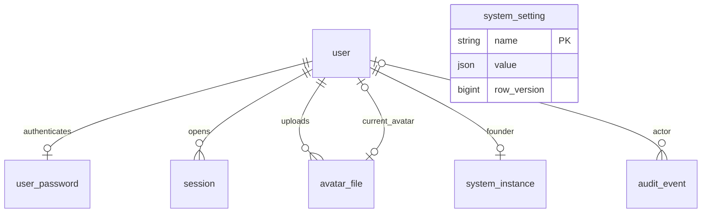

# 数据库设计

本稿面向 MySQL 8+，当前 DDL 的技术最低版本为 8.0.16，兼容目标覆盖 8.0、8.4；更高系列需经过同一迁移及仓储集成检查后声明支持，不把主版本号较大视为自动兼容。产品规则见 [设计入口](README.md)，结构阅读副本见 [schema.sql](schema.sql)。实际初始迁移已放入 `internal/store/migrations/mysql/00001_phase_a.sql` 并随二进制嵌入，由安装服务执行。MySQL 8.0 的真实初始迁移、种子事务、JSON/Unicode 回读及重复初始化保护已通过，8.4 尚待验证；不要手动导入阅读副本。

## 1. 表与关系

一期仅建七张业务表，不包含邮箱、租户、项目、团队、集成或工作流表。goose 会另行维护自己的迁移版本表 `goose_db_version`，业务代码不读写它。

设置是独立的系统级 KV，单租户数据库内不额外存 instance_id 外键。头像的上传者与当前使用者可以不同，例如管理员给他人上传；一个头像文件最多绑定一个用户。

| 表 | 主键 | 作用 |
| --- | --- | --- |
| `user` | 自增 ID | 用户资料、系统角色、状态、当前头像、认证/编辑版本、删除墓碑 |
| `user_password` | `user_id` | bcrypt 哈希、改密标记、密码修改时间 |
| `session` | 自增 ID | 会话令牌摘要、用户认证版本、过期与撤销信息 |
| `avatar_file` | 自增 ID | 随机存储路径、规范化图像属性、上传者及文件生命周期 |
| `system_setting` | 字符串 `name` | 注册表约束的 JSON 类型值、每项设置的编辑版本与时间 |
| `system_instance` | 固定 `id=1` | 安装 ID、唯一创始人引用、主密钥指纹、安装时间 |
| `audit_event` | 自增 ID | 业务事件、操作者及目标快照、受控变更信息 |

## 2. 通用约定

- 业务表统一使用单数 snake_case：`user`、`user_password`、`session`、`avatar_file`、`system_setting`、`system_instance`、`audit_event`；SQL 中统一用反引号引用表名。REST 集合路径仍为 `/admin/users` 等复数形式，不随表名变化。
- MySQL 8.0.16 起才执行 CHECK 约束，因此安装检查拒绝更早的 8.0 版本。DDL 与查询不引入 8.4 独有语法；实施 CI 至少覆盖 8.0 系列可用维护版本和 8.4 系列。8.4 容器标签只是部署示例，不再是唯一支持版本。
- 使用 InnoDB、`utf8mb4_0900_ai_ci`；用户名、枚举、令牌及标识符字段使用 ASCII 二进制比较。用户名只接收规范的小写 ASCII，唯一索引也覆盖已删除账号。
- 业务实体 ID 使用 `BIGINT UNSIGNED`；设置以 name 为主键，安装记录使用单例小整数。API 中 ID 与用户版本使用十进制字符串，避免 JavaScript 数字精度丢失；设置聚合版本为不透明摘要，客户端不解析版本。
- 时间存为 UTC `DATETIME(3)`；应用写入毫秒精度 UTC，连接设置 `time_zone='+00:00'`、`parseTime=true`、`loc=UTC`。界面按系统设置时区展示，修改时区不改历史数据。
- 不使用自动 `ON UPDATE` 时间列；业务服务明确更新 `updated_at`、版本和审计。最近登录时间只更新 `last_login_at`。
- 不用数据库 `ENUM`，使用短字符串与命名 `CHECK`；新状态通过迁移明确扩展。CHECK 只保护行内规则，跨表与权限规则由服务事务执行。
- 所有查询参数绑定，不拼接用户输入；排序字段使用服务端白名单。运行连接保持 `multiStatements=false`；goose 使用独立迁移连接，按工具要求开启 `multiStatements=true`，不可复用成请求连接。
- 结构草案不包含 `CREATE DATABASE`、初始用户数据或默认口令。部署者先提供专用空数据库与账号，安装服务创建业务种子。

## 3. 用户与凭据

`user.role` 只有 `admin`、`user`。`system_instance.founder_user_id` 唯一指定创始人，不新增 `founder` 角色值、不假定其 ID 为 1。外键只能防止硬删除该用户，不能阻止软删除、禁用或降级；这些保护必须由服务层在事务中执行。

`status` 只有 `active`、`disabled`。`deleted_at IS NOT NULL` 代表墓碑，并要求 `status=disabled`。常规列表、登录与当前账号查询统一排除墓碑；审计关联不依赖账号仍可登录。

| 字段 | 语义 |
| --- | --- |
| `username` | 登录标识，3–30 位，格式由 API 校验；删除后仍保留且不复用 |
| `display_name` | 1–30 个 Unicode 码点，支持中文、不唯一；存储宽度保留少量余量 |
| `auth_version` | 初值 1，安全事件递增；会话必须与当前用户版本一致 |
| `row_version` | 初值 1，资料、头像、角色、状态、密码或删除等实质变更递增，用于 If-Match |
| `avatar_file_id` | 可空外键；唯一索引允许多个 NULL，但同一非空头像只能绑定一个用户 |
| `last_login_at` | 登录成功时更新，不改变编辑版本 |

一期本地登录账号正常或禁用时必须有凭据。逻辑删除时删除 `user_password` 行，保留用户行并撤销全部会话。凭据哈希为库生成的完整 bcrypt 字符串，包含算法标识、cost 和盐；不单列盐、不保存明文或可逆密码。`password_hash VARCHAR(255)` 保留算法迁移余量，不把字段限制为当前哈希长度。保留独立凭据表的评估见 [扩展性设计](extensibility.md)：未来外部身份独立关联，不要求无本地登录方式的用户伪造密码。

密码参数升级如只在成功登录后重新哈希，且密码本身未变，不改变 `password_changed_at`、`row_version` 或撤销会话。实现时以锁定后读取的当前哈希为准，不能用并发登录的旧哈希覆盖刚重置的新密码。

## 4. 会话

`token_hash` 为随机会话令牌的 SHA-256 二进制值，唯一索引用于定位。数据库及审计均不保存可直接使用的令牌。`auth_version` 保存创建时的用户认证版本；角色仍从当前 User 读取。

会话有效需同时满足：账号正常、未删除、有凭据、版本匹配、未撤销、当前时间早于 `expires_at`。是否要求改密也读取当前凭据。禁用后即使清理任务未运行，旧会话也失效。

`ttl_days` 保存会话创建时的 `session_ttl_days`，默认 30，范围 1–30；它是滑动续期窗口，不是固定绝对有效期。创建时 `created_at=last_seen_at=now`、`expires_at=now+ttl_days`。修改设置只影响之后创建的会话。

每次通过认证与权限校验的业务 API 访问，在事务中按用户、会话顺序锁定并重新检查有效性，再更新 `last_seen_at` 与 `expires_at`。时间取值不得使 last_seen_at 或 expires_at 倒退，续期提交后才刷新 Cookie。已撤销、到期、禁用、删除或认证版本不匹配不能续期；普通读操作的续期不递增用户编辑版本，也不逐次写业务审计。公开请求及退出/撤销路径不续期，一期不做前端保活心跳或绝对最大会话时长。

清理任务锁定到期行并重新校验后才删除，不能根据旧查询结果删除已续期会话。清理可删除已过期行与撤销超过 30 天的行；业务审计独立保留。其他存储适配器也必须保证续期与撤销、清理并发时不会复活或误删有效会话。

`ip_address` 与 `user_agent` 仅作追踪，不绑定会话到特定 IP。客户端信息截断到字段上限，不保存任意代理头；IP 解析只信任显式配置的反代。

## 5. 头像

`storage_key` 是服务端随机生成的相对路径，如 `avatars/ab/<random>.png`，映射到 `<data>/media/`。不使用原文件名、不接受客户端路径；`sha256` 用于完整性与响应 ETag，不作为跨用户去重依据。

| 状态 | 时间字段 | 允许的转移 |
| --- | --- | --- |
| `staged` | `expires_at` 非空，建议上传后 24 小时 | 在过期前绑定为 attached，或删除 |
| `attached` | 两个生命周期时间均为空 | 替换、移除或删除账号后变 orphaned |
| `orphaned` | `orphaned_at` 非空 | 无用户引用且满 24 小时后清理；不重新绑定 |

绑定时锁定目标用户、草稿与旧文件元数据，校验上传者等于当前操作者、草稿未过期、目标权限及版本；更新用户引用、两份文件状态和审计共用一个事务。管理员替他人上传时，草稿上传者仍为管理员。

文件先在内存中规范化，再写入数据目录的私有临时文件并原子移动到最终随机路径，最后提交 `avatar_file`。数据库提交失败可能留下没有元数据的磁盘文件，清理器只扫描符合本应用随机路径规则、超过 24 小时且无元数据的文件，包括中断遗留的 `.tmp-<random>`；删除前再次检查元数据并跳过在途上传。不能笼统删除未知目录或刚上传文件。维护循环在 ready 状态启动并每小时执行，元数据每批最多 100 行，磁盘候选每次最多 500 个；回收失败保留重试，访问权限与过期判断不依赖清理准时运行。

垃圾清理锁定文件行并重新确认没有用户引用，先删除数据库元数据再删除文件。文件删除失败记录待重试日志，并由上述无元数据扫描回收。外键防止删掉当前引用；不通过级联删除头像文件。

## 6. 受控设置 KV 与安装记录

`system_setting` 改为每项配置一行的受控 KV，主键列名为 `name`，不另建自增 id。配置名使用小写命名空间，`value` 为 JSON，保留字符串、布尔、整数等真实类型；不把所有值转成字符串。应用注册表定义类型、默认值、校验、敏感性及可编辑性，不向管理员开放任意配置名写入；当前各项都不允许 null，单值上限暂定 16 KiB。

| 存储 name | JSON 类型 / 默认值 | API 字段与校验 |
| --- | --- | --- |
| `site.name` | string / `"OctoDCP"` | site_name，1–40 码点 |
| `site.timezone` | string / `"Asia/Shanghai"` | timezone，IANA 时区 |
| `auth.registration_enabled` | boolean / `false` | registration_enabled |
| `auth.session_ttl_days` | integer / `30` | session_ttl_days，1–30 |

注册默认关闭已经确认；其余默认值的确认状态见 [设计入口](README.md)。安装在种子事务中创建完整四行；以后新增键由配套迁移补齐，不能在请求中靠无锁插入补行。缺失或类型不符属于需要维护的配置错误，不静默跳过注册策略。IANA 时区校验由应用完成，Go 程序嵌入时区数据。

每项配置都有 `row_version`。设置 GET 以一份一致快照读取该视图全部配置，将注册表版本、排序后的 name、行版本及按定义类型规范编码的值组合，计算 SHA-256 聚合版本；API 将其作为不透明字符串和 ETag。PATCH 在事务内按 name 字典序锁定全部相关配置，重新校验聚合版本，再更新有变化的行并写审计；即使值后来改回原值，行版本已变化，旧 If-Match 仍会冲突。无变化不递增任何行版本。

注册流程只锁定 `auth.registration_enabled` 并重新检查，和设置修改共享这一个原子边界；开放时直接创建 active 普通用户及会话，无需审批，关闭不撤销已创建账号。KV 不保存数据库配置、主密钥、密码、外部系统凭据或工作流/任务实体。API 仍返回四个具体字段，不暴露通用 KV 编辑器。

只有 `system_instance` 保留 `CHECK(id=1)`；“安装后恰好一行”由安装事务及启动校验保证。其创始人引用等身份字段不可通过业务 API 修改，不用它承载设置版本计数。

`installation_id` 是 16 字节随机值的小写 32 位十六进制编码，与本地配置及安装标记一致。`key_fingerprint` 为 32 字节主密钥的 SHA-256，仅用于启动匹配，不代替主密钥，不通过业务 API 返回。主密钥文件与加密数据库口令均不放入业务表。

## 7. 审计

审计按 `occurred_at DESC, id DESC` 游标翻页，不能用时间戳单独作唯一游标。保存用户与系统两种操作者；用户 ID 允许为空，以支持系统恢复命令及未来物理归档。用户名、显示名称与目标标签为当时快照，不因用户后来改名而变。

`detail` 只允许 JSON 对象，字段由各操作白名单构造。例如角色修改保存 `{"changes":{"role":{"before":"user","after":"admin"}}}`；密码事件只保存变更类别和是否强制改密，不保存密码内容或哈希。没有任意请求体透传字段。

`target_id` 使用字符串以容纳设置视图及后续不同模块目标，不建立多态外键。设置仍以一个 `settings.updated` 事件记录本次白名单字段变更，不按底层 KV 行拆成多次操作。动作命名及 API 返回格式见 [API 设计](api.md)。审计时间、动作、操作者及目标有对应索引；按动作前缀筛选后仍需按时间排序，一期可接受小规模结果集排序，不预先建立全文索引。

## 8. 事务与并发

| 用例 | 同一数据库事务中的变化 |
| --- | --- |
| 完成安装种子 | 创始人、凭据、系统设置、安装记录、`installation.completed` 审计 |
| 自主注册 | 锁定并重新检查注册开关、创建用户与凭据、创建会话、注册审计 |
| 登录成功 | 重新核验用户与凭据、创建会话、最近登录时间、登录审计 |
| 修改资料/头像 | If-Match 校验、用户与文件状态、编辑版本、变更审计 |
| 修改密码 | 凭据、认证与编辑版本、撤销所有会话、审计 |
| 改角色/禁用/启用 | 操作者与目标校验、目标状态、认证与编辑版本、撤销所有目标会话、审计 |
| 删除账号 | 墓碑、删除凭据、撤销会话、头像解绑、认证与编辑版本、审计 |
| 修改设置 | 锁定视图涉及的 KV、校验聚合 If-Match、更新变化键及行版本、审计 |

事务默认使用 READ COMMITTED，依靠明确的行锁和唯一约束实现用例一致性，不假定读取快照即可避免竞争。敏感操作按 [领域规则](domain-model.md) 的顺序锁定操作者与目标；锁等待或死锁仅在可安全重试的整个事务边界做有界重试，不重复文件写入或发送响应。

登录先在事务外执行昂贵的哈希校验，再在事务内锁定用户和凭据、确认哈希与认证版本仍等于校验版本；若已变化则重新验证或拒绝该次登录，避免改密后旧口令仍建立会话。敏感操作的版本冲突返回 412，用户名唯一冲突映射为 409，不把驱动报错或 SQL 返回客户端。

## 9. 迁移与验证边界

实现时将结构拆入带版本的 goose 迁移，不直接在运行服务中执行本文件，不用 `IF NOT EXISTS` 掩盖错误结构。迁移账户需要相应 DDL 权限；运行账户只需业务读写权限，允许部署者在安装/迁移后切换为最小权限账号。

MySQL DDL 会隐式提交，不能靠一个事务撤销整次安装。恢复、备份和升级流程见 [部署设计](deployment.md)。实现验收必须在目标 MySQL 上运行全新建库、升级及安装中断场景；本次文档阶段只进行结构与契约一致性检查。

MySQL 语法约束参考：[MySQL 8.0 CHECK 支持起点](https://dev.mysql.com/doc/refman/8.0/en/create-table-check-constraints.html)、[DDL 隐式提交](https://dev.mysql.com/doc/refman/8.4/en/implicit-commit.html)；迁移连接参数参考 [goose 官方说明](https://github.com/pressly/goose)。
