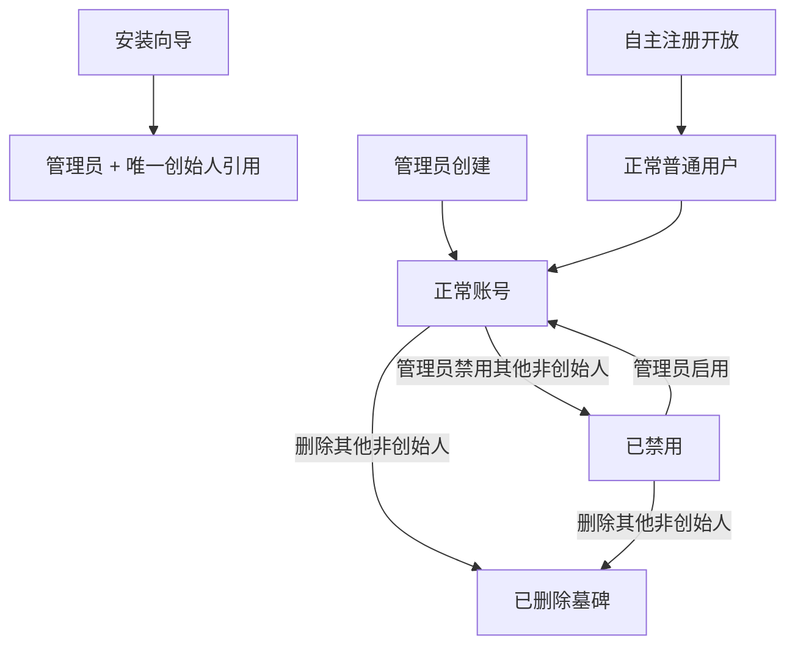
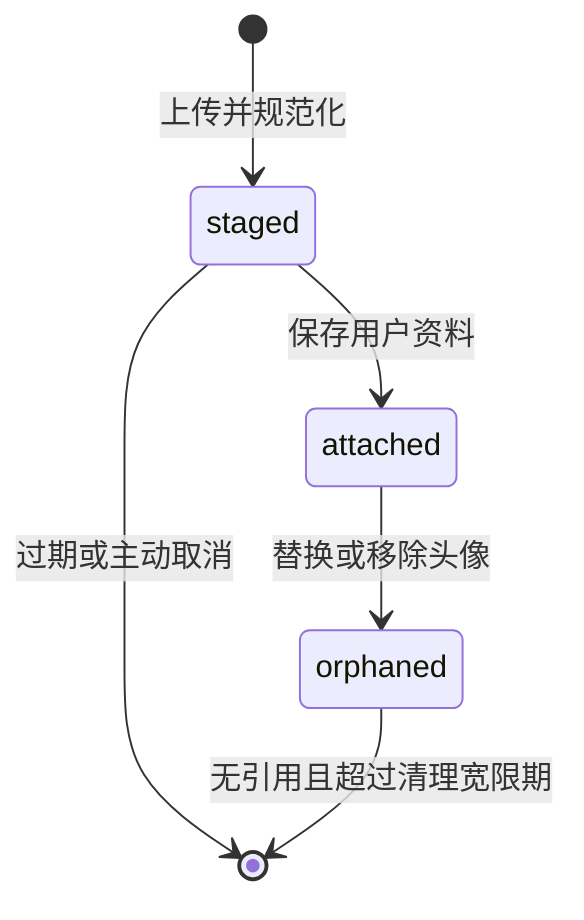

# 领域模型与权限

规则状态以 [设计入口](README.md) 为准。注册、账号删除与修改、首次改密、新密码最少 8 个字符、默认 30 天自动续期均已确认。实现不能因便利而弱化创始人保护或会话撤销。

## 1. 领域对象

| 对象 | 核心含义 |
| --- | --- |
| User | 稳定用户 ID、用户名、显示名称、系统角色、账号状态和头像引用；没有邮箱 |
| UserPassword | 本地密码哈希、密码变更时间、首次登录改密标记，与 User 一对零或一 |
| Session | 已验证的登录会话、创建时的续期窗口、滑动过期时间与撤销状态 |
| SystemInstance | 单例安装记录，持有唯一创始人 ID、安装 ID、主密钥指纹 |
| SystemSettings | 四个有类型的业务设置视图；由受注册表约束的 KV 记录组成 |
| AvatarFile | 已规范化的头像草稿或已绑定文件；文件内容位于数据目录 |
| AuditEvent | 不可由业务 API 修改的操作记录，包含操作者快照和经过筛选的变更信息 |

创始人不是可选角色。User 的 `role` 只有 `admin`、`user`；当其 ID 等于 SystemInstance 的 `founder_user_id` 时，对外显示 `is_founder=true`，其 `role` 必须保持 `admin`。一期不提供修改创始人 ID 的业务或管理 API，也不根据最小用户 ID、用户名或创建时间推断创始人。

## 2. 身份与状态

创始人始终正常、未删除。删除是已确认的终态：界面不可恢复，凭据删除、会话全部撤销、头像解绑，用户 ID 和用户名保留；不提供相同用户名的重新注册。数据库仍保留 User 墓碑以支持审计及后续关联。

`require_password_change` 是凭据限制，不是第三种账号状态。账号正常但必须改密时，只能读取当前会话、取得 CSRF、修改自己的密码、读取自己的当前头像或退出。不能借此会话调用用户管理、系统设置、审计或上传接口。

## 3. 一期权限矩阵

“管理员”列包含创始人在其普通管理员权限下的能力；额外的创始人保护始终优先。

| 操作 | 普通用户 | 管理员 |
| --- | --- | --- |
| 首页、自己的资料与头像 | 可以 | 可以 |
| 修改自己的密码 | 验证当前密码后可以 | 验证当前密码后可以 |
| 进入控制台、查看全站用户和审计 | 不可以 | 可以 |
| 系统设置、创建普通用户/管理员 | 不可以 | 可以 |
| 修改其他普通用户或管理员资料、头像 | 不可以 | 可以 |
| 重置其他普通用户或管理员密码 | 不可以 | 可以，强制其下次改密 |
| 修改创始人资料、头像、用户名 | 不可以 | 仅创始人本人 |
| 重置创始人密码 | 不可以 | 不能代重置；本人正常改密，维护者通过本地恢复命令处理遗失 |
| 提升/取消其他用户管理员身份 | 不可以 | 可以，创始人除外 |
| 禁用、删除其他用户 | 不可以 | 可以，创始人除外 |
| 禁用、删除、降级自己 | 不可以 | 不可以 |

系统不存在超级管理员与次级管理员的差别。保留的创始人确保始终存在可管理系统的账号，因此不另设“最后一位普通管理员”保护。普通用户不能通过自助接口修改角色、状态、用户名或改密标记。

## 4. 账号创建与修改

用户名规则为 `^[a-z0-9][a-z0-9_-]{2,29}$`，仅允许小写 ASCII，不自动截断或悄悄转写。用户名用于登录，用户 ID 用于所有关联。显示名称为 1–30 个 Unicode 码点，可使用中文，不要求唯一。

- 安装：原子创建创始人、其凭据、默认设置和唯一安装记录；没有默认账号或预置口令。
- 管理员创建：显式指定 `user` 或 `admin`，新账号正常，`require_password_change=true`。
- 自主注册：安装后默认关闭，管理员开启后无需审批；必须在事务中重新检查注册开关，固定创建正常 `user`，不能提交角色。用户、凭据、登录会话和注册审计一并提交，成功后自动登录并进入首页。关闭注册只阻止之后提交的新注册，不影响已创建账号或管理员创建账号。
- 个人修改：允许显示名称、头像；用户名只读，没有邮箱。
- 控制台修改：可改显示名称、用户名与头像；角色、状态、密码走独立命令。
- 本人改密：验证当前密码，旧密码与新密码不能相同。撤销全部会话，清除改密标记；响应后回到登录页。
- 管理员重置他人密码：不返回密码，撤销其全部会话并设置改密标记。重置自己的密码必须改走本人改密接口。

密码使用 bcrypt，新密码至少 8 个 Unicode 码点且最多 72 UTF-8 字节；不要求大小写、数字、符号必须组合。注册、安装、创建和重置采用相同的新密码规则；登录不强制套用新的最小长度，但同样拒绝超出 bcrypt 72 字节范围的输入，绝不截断。前端同时提示字节上限，不能只使用 HTML maxlength 计数；具体取舍见 [方案比较](technology-decisions.md)。

## 5. 会话失效与并发规则

登录和注册建立持久化 Cookie 会话，滑动窗口默认 30 天，可配置 1–30 天。窗口在创建时复制到 `session.ttl_days`；修改系统设置只影响新会话，已有会话继续使用创建时的窗口。

通过认证与权限校验的业务 API 访问自动把 `last_seen_at` 更新到当前时间，并将 `expires_at` 延长至当前时间加该窗口；同一提交结果用于刷新 Cookie 的 Expires / Max-Age。公开页面、静态资源、健康检查、失败认证和无权限请求不续期，退出或撤销操作不先续期。不依靠前端定时心跳保活，一期不另设绝对最长登录时限。

连续一个窗口没有有效访问则会话到期；已到期、已撤销或用户认证版本已变化的会话不能续期。并发更新不得缩短过期时间，续期和撤销使用一致的用户/会话锁顺序；即使退出前发出的响应稍后写回旧 Cookie，已撤销令牌也不能重新生效。

禁用、启用、删除、角色变更、本人改密、管理员重置和本地密码恢复均递增用户 `auth_version` 与 `row_version` 并撤销已有会话。身份变更后的用户重新登录；不在 Cookie 中缓存管理员身份。

资料与头像变更不撤销会话，只递增 `row_version`。最近登录时间及会话活跃时间不改变用户资料版本，避免用户登录造成编辑冲突。

每个敏感写操作在事务内：读取单例创始人引用，按 ID 升序锁定操作者和目标用户，重新验证操作者的角色、状态及会话版本，再执行目标保护、版本校验、写入和审计。两位管理员同时禁用对方时，后取得锁的一方必须重新检查其自身权限，不能靠事务前的认证快照继续操作。

## 6. 头像生命周期

客户端手动裁剪为正方形；服务器重新解码校验，生成统一 256×256 PNG。输入允许 JPEG、PNG、WebP，最大 2 MiB；最大边长 4096、总像素不超过 16,777,216；输出不超过 512 KiB。服务端编码器丢弃来源元数据，不信任扩展名和客户端 MIME。

上传只产生当前操作者拥有的草稿，建议有效期 24 小时。保存资料时校验草稿归属、有效期及目标用户权限，在一个数据库事务中绑定新头像并把旧头像标记为无引用。当前阶段同一文件只绑定一个用户，不做全站内容去重。取消裁剪不上传；取消表单可删除草稿，未主动删除的草稿最终过期。

普通用户只能给自己上传、绑定或移除；管理员可以给其他非创始人操作。创始人头像只能本人修改。已绑定头像只向已登录用户提供；草稿仅上传者可预览。文件 URL 指向 API，不直接暴露磁盘目录。

## 7. 设置与审计

SystemSettings 对调用者保持明确字段，存储采用受控 KV。键名、类型、默认值、校验和是否可通过控制台编辑都由服务端注册表定义，没有任意键读写 API。当前四个键为 `site.name`、`site.timezone`、`auth.registration_enabled`、`auth.session_ttl_days`；对应系统名称、时区、注册开关和会话有效期。公开访问地址、可信反代、数据库和数据路径仍属部署配置，控制台只读展示，密码和外部凭据不进入设置 KV。详见 [扩展性设计](extensibility.md)。

关键写操作与审计事件在同一个数据库事务内提交。事件至少包括安装完成、注册、登录成功、退出、资料修改、头像变更、密码变更/重置、角色变更、禁用/启用、删除和设置修改。无实质变化的幂等写操作不递增版本、不重复生成变更事件。

审计保存操作者 ID 及当时的用户名、显示名称快照；目标 ID 与标签也同时保存。只记录允许公开给管理员的字段差异。密码、哈希、会话令牌、CSRF、数据库口令、主密钥、上传内容与完整请求体一律不写入审计。登录失败写限流后的安全日志，暂不逐次写入业务审计表。

一期没有审计删除 API，暂不自动删除审计事件。后续保留期与归档策略另行讨论。部署恢复命令同样产生 `actor_type=system` 的审计记录，不伪装成创始人本人操作。
